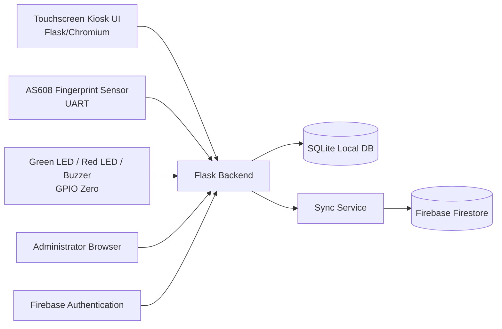

# EARIST Technozette Biometric-Based Digital Logbook Monitoring System with Kiosk

Python/Flask prototype for Windows development and Raspberry Pi deployment.

## Scope guardrails
- Supported classifications only: **Cartoonist**, **Writer**, **Photojournalist**.
- No reason-for-entry, no facial recognition, no GPS, no AI fingerprint recognition.
- Admin credentials are handled by Firebase Authentication; passwords are not stored in SQLite/Firestore.

## Project structure

```text
app/
  __init__.py              # Flask app + routes
  attendance.py            # Time In/Time Out + debounce transaction logic
  auth.py                  # Firebase token verification + route guard
  config.py
  constants.py
  db.py
  firebase_sync.py         # Firestore synchronization service
  hardware/
    fingerprint.py         # AS608 UART abstraction + mock
    gpio.py                # GPIO feedback abstraction + mock
  templates/
  static/
migrations/001_initial.sql # SQLite schema and indexes
scripts/init_db.py
tests/
run.py
.env.example
requirements.txt
```

## System architecture



## ERD

```mermaid
erDiagram
  ADMINISTRATOR ||--o{ USER : registers
  USER ||--o{ ATTENDANCE_LOG : logs

  ADMINISTRATOR {
    text AdminID PK
    text Username
    text Status
  }
  USER {
    text UserID PK
    text AdminID FK
    text Name
    int FingerprintID UNIQUE
    text Classification
    text Status
    text EnrollmentStatus
  }
  ATTENDANCE_LOG {
    text LogID PK
    text UserID FK
    text Date
    text TimeIn
    text TimeOut
    int Duration
    text SyncStatus
  }
```

## Database schema highlights
- Stable IDs (UUID text) used as local and cloud document IDs.
- Unique `FingerprintID` in `USER`.
- Partial unique index enforces one open attendance session per user (`TimeOut IS NULL`).
- `Duration` remains `NULL` until Time Out is recorded.

## Attendance behavior
1. Member scan found and active.
2. If no open session: insert `TimeIn` record.
3. If open session exists: set `TimeOut` and compute `Duration`.
4. Debounce blocks immediate repeated scans (`DEBOUNCE_SECONDS`).

## Firestore synchronization
- Uploads local members and pending/failed attendance when online.
- Uses local `UserID`/`LogID` as Firestore doc IDs for idempotency.
- Marks logs `synced` on success, `failed` on retryable failure.
- Offline or config failure preserves local data and reports explicit error.

## AS608 + GPIO wiring (Raspberry Pi 4)

| Component | Signal | RPi Physical Pin | BCM GPIO | Notes |
|---|---|---:|---:|---|
| AS608 | TX | 10 | GPIO15 (RXD) | Sensor TX -> Pi RX |
| AS608 | RX | 8 | GPIO14 (TXD) | Sensor RX <- Pi TX |
| AS608 | VCC | 2 or 4 | 5V | Verify module voltage requirements |
| AS608 | GND | 6 | GND | Common ground |
| Green LED | Anode via 220Ω | 11 | GPIO17 | Cathode to GND |
| Red LED | Anode via 220Ω | 13 | GPIO27 | Cathode to GND |
| Buzzer driver input | Control | 15 | GPIO22 | Use transistor/driver as required by buzzer current |

**Buzzer caution:** drive through a suitable transistor/driver circuit when needed; do not exceed GPIO current limits.

## Touchscreen/kiosk behavior
- Open `/kiosk` in Chromium kiosk mode.
- Workflow: prompt -> scan -> match -> show name/classification -> auto Time In/Time Out -> save -> LED/buzzer feedback -> reset prompt.

## Windows setup
1. Install Python 3.11+.
2. `python -m venv .venv && .venv\Scripts\activate`
3. `pip install -r requirements.txt`
4. Copy `.env.example` to `.env` and adjust values.
5. `python scripts/init_db.py`
6. `python run.py`

## Raspberry Pi setup
1. Install 64-bit Raspberry Pi OS and enable UART.
2. Install Python + dependencies from `requirements.txt`.
3. Set `.env` with `USE_MOCK_HARDWARE=0`, UART port (`/dev/serial0`), GPIO pins.
4. Configure Firestore credentials path and project ID.
5. Launch Flask and open Chromium kiosk URL `/kiosk`.

## Firebase setup and security guidance
- Create Firebase project and service account JSON.
- Set `FIREBASE_CREDENTIALS_FILE` and `FIREBASE_PROJECT_ID`.
- Use Firebase Auth for administrator sign-in.
- Restrict Firestore writes to trusted backend/service account and least privilege.
- Example rule concept:
  - deny client writes to attendance/member docs unless explicitly required by backend design.

## Hardware test procedure (manual)
1. Confirm UART serial visibility on Pi.
2. Enroll a fingerprint and verify `EnrollmentStatus` updates.
3. Perform recognized and unrecognized scans.
4. Verify green LED + single beep for success; red LED + double beep for failure.
5. Verify Time In then Time Out and duration.

## Functional checklist
- [ ] Admin Firebase token login succeeds
- [ ] Register/edit member with allowed classification
- [ ] Fingerprint enrollment association works
- [ ] Kiosk records Time In then Time Out automatically
- [ ] Dashboard and attendance filters show expected data
- [ ] Sync status updates after Firestore sync

## Offline/sync test procedure
1. Disable network; perform scans; verify local logs are saved as pending/failed.
2. Re-enable network; run sync; verify cloud docs created with same IDs and local status becomes synced.
3. Re-run sync; confirm no duplicates.

## Notes
- Provide your own Firebase credentials; none are included.
- Raspberry Pi hardware behavior (sensor/GPIO) must be validated by the developer on actual hardware.
- This repository does not claim completed hardware-in-the-loop testing.
